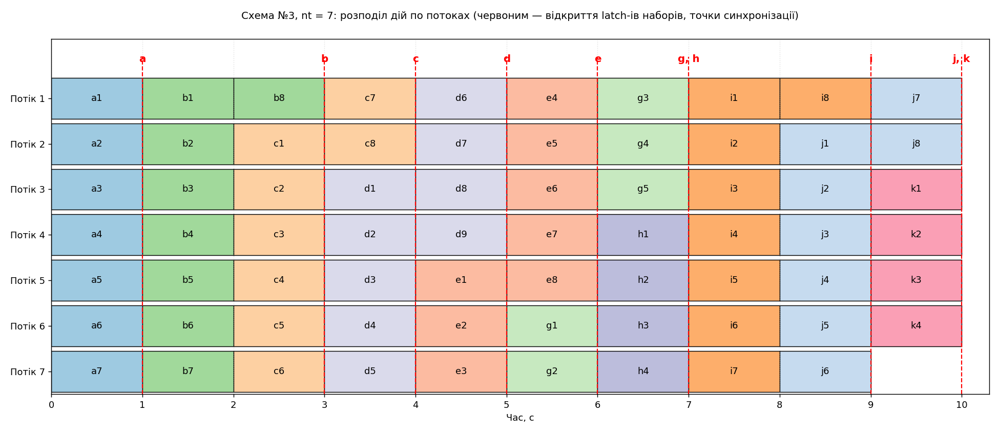

# Програмний проєкт №3

Виконання обчислення за схемою (орграф із мітками дуг) у `nt` потоках за мінімальний загальний час. **Варіант 3:** схема №3, `nt = 7`, a=7, b=8, c=8, d=9, e=8, g=5, h=4, i=8, j=8, k=4 (набори f, m, n у схемі №3 відсутні)

**Виконавець:** [Чеверда Давид], група [K-27]

## Умова

Кожна дуга схеми — набір дій; параметр з іменем дуги задає кількість дій у наборі. Дії набору можна розпочинати лише тоді, коли виконано всі дії всіх наборів, що входять у початковий вузол дуги. Дії одного набору між собою незалежні. Одну дію не можна ділити між потоками. Крім потоку з `main` запускається рівно `nt` потоків; `main` дій не виконує. Розподіл дій по потоках і порядок виконання задано жорстко (hardcoded). Дія `f(x, i)` — заглушка: потік спить 1 секунду й виводить `З набору x виконано дію i.

## Схема №3 як залежності

Вузли: S → A → U, M, L → X, Y → T.

| Набір | Дуга   | Дій | Починається після завершення |
|-------|--------|-----|------------------------------|
| `a`   | S → A  | 7   | —                            |
| `b`   | A → U  | 8   | `a`                          |
| `c`   | A → M  | 8   | `a`                          |
| `d`   | A → L  | 9   | `a`                          |
| `e`   | U → X  | 8   | `b`                          |
| `g`   | M → X  | 5   | `c`                          |
| `h`   | M → Y  | 4   | `c`                          |
| `i`   | L → Y  | 8   | `d`                          |
| `j`   | X → T  | 8   | `e`, `g`                     |
| `k`   | Y → T  | 4   | `h`, `i`                     |

## Розв'язок

- Кожному набору відповідає `std::latch` з лічильником, що дорівнює кількості його дій. Потік, виконавши дію, робить `count_down()`; коли виконано всі дії набору, latch відкривається — це **точка синхронізації**
- Перед дією потік викликає `wait()` на latch-ах наборів, від яких вона залежить (функція `wait_for_dependencies` у `src/main.cpp`)
- Дії розподілено по потоках заздалегідь (`PLANS` у `src/schedule.h`); кожен потік виконує свій список по порядку. Кожна дія стоїть після тих, від яких залежить, тому взаємного блокування бути не може.
- Потоки — `std::jthread`, вивід — `std::osyncstream` (рядки різних потоків не змішуються). `semaphore` та `barrier` не потрібні

### Чому час мінімальний

Усього дій: 7+8+8+9+8+5+4+8+8+4 = **69**. Семеро потоків за одну секунду виконують не більше 7 дій, тому час не менший за 69/7 ≈ 9,86, тобто **не менше 10 с**. Розклад нижче вкладається рівно в **10 с**, отже він оптимальний. У кожну секунду, крім останньої, зайнято всі 7 потоків, тож потік не простоює, поки є доступна дія, яку ще не розпочато. Розклад перевірено моделюванням виконання (залежності, відсутність блокувань) і реальними запусками; ThreadSanitizer гонок даних не виявив

| Секунда | Дії (набір × кількість) | Зайнято потоків |
|---------|-------------------------|-----------------|
| 1       | `a` × 7                 | 7               |
| 2       | `b` × 7                 | 7               |
| 3       | `b` × 1, `c` × 6        | 7               |
| 4       | `c` × 2, `d` × 5        | 7               |
| 5       | `d` × 4, `e` × 3        | 7               |
| 6       | `e` × 5, `g` × 2        | 7               |
| 7       | `g` × 3, `h` × 4        | 7               |
| 8       | `i` × 7                 | 7               |
| 9       | `i` × 1, `j` × 6        | 7               |
| 10      | `j` × 2, `k` × 4        | 6               |

## Діаграма

На діаграмі: рядок — потік, блок — дія (`b3` = третя дія набору `b`), червоні пунктири — моменти, коли відкриваються latch-і наборів (точки синхронізації)



## Збирання

Потрібен компілятор з підтримкою C++20 (`<latch>`, `<syncstream>`): g++ 11+ або MSVC 19.29+

Без CMake:

```
g++ -std=c++20 -pthread src/main.cpp src/work.cpp -o prog
```

Через CMake (3.25+):

```
cmake --preset default
cmake --build --preset default
```

У MSVC прапорець `/utf-8` потрібен, бо код і вивід містять кирилицю (у `CMakeLists.txt` він уже доданий)

## Запуск

```
prog.exe
prog.exe > results.txt
```

Вхідних даних немає. На Windows програма сама переключає консоль на UTF-8. Для перенаправлення в файл використовуйте `cmd`: у Windows PowerShell 5.1 оператор `>` зберігає файл у UTF-16. Порядок рядків в межах однієї секунди може відрізнятися від запуску до запуску

## Скріншоти

Збирання: `screenshots/build.png`

Робота програми: `screenshots/run.png`

## Структура проєкту

```
ProgProj3/
├── .gitignore
├── CMakeLists.txt
├── CMakePresets.json
├── README.md
├── diagram.png               діаграма розподілу по потоках і точок синхронізації
├── results.txt               вивід програми
├── screenshots/
│   ├── build.png             результат збирання
│   └── run.png               результат роботи програми
└── src/
    ├── main.cpp              запуск nt потоків, latch-і, вимірювання часу
    ├── schedule.h            жорстко задані плани потоків
    ├── work.h                оголошення заглушки f(x, i)
    └── work.cpp              заглушка f: сон 1 с і вивід через osyncstream
```
